<div align="center">

# 🚀 Gabarito Plus

**Sistema móvel para geração e correção automatizada de provas utilizando visão computacional.**


</div>

## 👥 Equipe

| Nome completo |
|---|
| Enrique Zoz de Souza|
| Felipe Vieira |
| Natan Felipe Valente |
| Vicenzo Luiggi Mori |
| Esther Rigol de Souza |

## 📑 Sumário

- [1. Visão Geral](#1-visão-geral)
- [2. Requisitos](#2-requisitos)
  - [2.1 Funcionais (RF)](#21-funcionais-rf)
  - [2.2 Não Funcionais (RNF)](#22-não-funcionais-rnf)
- [3. Funcionalidades](#3-funcionalidades)
  - [3.1 Telas do Sistema](#31-telas-do-sistema)
- [4. Modelo de Dados](#4-modelo-de-dados)
- [5. Stack Tecnológica](#5-stack-tecnológica)
- [6. Estrutura de Pastas](#6-estrutura-de-pastas)
- [7. Como Executar o Projeto](#7-como-executar-o-projeto)
- [8. Testes](#8-testes)
- [9. Backlog de Atividades](#9-backlog-de-atividades)
  - [9.1 Backlog da N3](#91-backlog-da-n3)
  - [9.2 Backlog da N2](#92-backlog-da-n2)

---

## 1. Visão Geral

📌 **N1 / N2 / N3**

O **Gabarito Plus** é uma plataforma educacional projetada para mitigar o tempo gasto por professores na criação, aplicação e correção de avaliações. O público-alvo são docentes e instituições de ensino que buscam agilidade no dia a dia. A solução permite que o professor gerencie seu próprio banco de questões, gere provas com alternativas embaralhadas de forma dinâmica e, como principal diferencial, realize a correção instantânea dos gabaritos dos alunos apenas apontando a câmera do celular através de visão computacional (QR Code/Leitura óptica).

## 2. Requisitos

📌 **N1 / N2 / N3**

### 2.1 Funcionais (RF)

| Código | Requisito |
|---|---|
| RF01 | O sistema deve permitir o cadastro e gerenciamento de perfis de professores. |
| RF02 | O sistema deve permitir o gerenciamento (CRUD) de turmas e alunos. |
| RF03 | O sistema deve permitir o cadastro e organização de disciplinas, assuntos e questões. |
| RF04 | O sistema deve gerar provas personalizadas com embaralhamento de questões e alternativas. |
| RF05 | O sistema deve permitir a leitura e correção automática de gabaritos utilizando a câmera (via QR Code/Visão Computacional). |
| RF06 | O sistema deve permitir a consulta do histórico de provas corrigidas e seus respectivos detalhes/notas. |
| RF07 | O sistema deve permitir personalizar o layout das provas exportadas em PDF (fonte, espaço para resolução, cabeçalho e instruções). |
| RF08 | O sistema deve permitir importar alunos a partir de planilhas (`.csv` / `.xlsx`). |
| RF09 | O sistema deve exibir dashboards de desempenho por turma, por aluno e estatísticas por questão/alternativa. |

### 2.2 Não Funcionais (RNF)

| Código | Requisito |
|---|---|
| RNF01 | O aplicativo deve rodar perfeitamente em dispositivos móveis. |
| RNF02 | O sistema precisa solicitar e utilizar o acesso à câmera nativa do aparelho para as correções. |
| RNF03 | O armazenamento, consulta e persistência dos dados devem ser feitos em nuvem de forma escalável utilizando o ecossistema Firebase (Firestore/Auth). |

## 3. Funcionalidades

📌 **N1 / N2 / N3**

- **Autenticação**: login, cadastro de professor e recuperação de senha via Firebase Auth. Cada professor enxerga apenas os próprios dados.
- **Turmas e alunos**: CRUD completo, ativação/inativação e **importação de alunos por planilha** (`.csv` ou `.xlsx`).
- **Disciplinas, assuntos e questões**: banco de questões organizado por disciplina e assunto, com edição e exclusão.
- **Geração de provas**: escolha de turma, assunto específico ou **todos os assuntos da disciplina** e questões; suporte ao **sorteio de um subconjunto de questões por aluno** (`questoesPorProva`), além de embaralhamento independente de questões e alternativas, gerando uma **versão individual por aluno**, identificada por QR Code.
- **Exportação em PDF**: provas dos alunos com folha de respostas (OMR) e **gabarito do professor em PDF separado**. O layout das questões é personalizável (fonte, linhas/espaço para cálculos, nome da instituição, instruções e exibição opcional de data e nota no cabeçalho), mantendo a geometria fixa da folha de respostas (OMR) para leitura óptica.
- **Correção automática**: leitura do QR Code da versão e captura da folha de respostas pela câmera, com detecção das marcações via **OpenCV (OMR)**. As respostas lidas passam por uma tela de conferência antes de salvar; sem câmera disponível, a marcação pode ser feita manualmente.
- **Provas corrigidas**: histórico com filtros, detalhes de cada correção (acertos, erros, em branco e nota de 0 a 10).
- **Desempenho**: dashboards por turma e por aluno, distribuição de notas e estatísticas por questão e por alternativa marcada.

### 3.1 Telas do Sistema

**Acesso e cadastros:** autenticação do professor, hub de módulos e banco de questões filtrável por disciplina e assunto.

| Login | Dashboard |
|:---:|:---:|
|  | 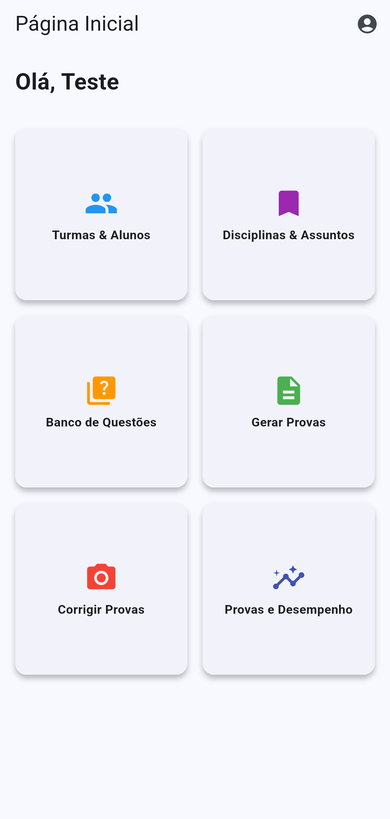 |

| Banco de Questões |
|:---:|
|  |

**Geração de provas:** configuração da prova, versões embaralhadas por aluno (com código e gabarito) e a folha de respostas do PDF, com QR Code e os marcadores usados pela leitura óptica.

| Configuração da Prova | Embaralhamento |
|:---:|:---:|
| 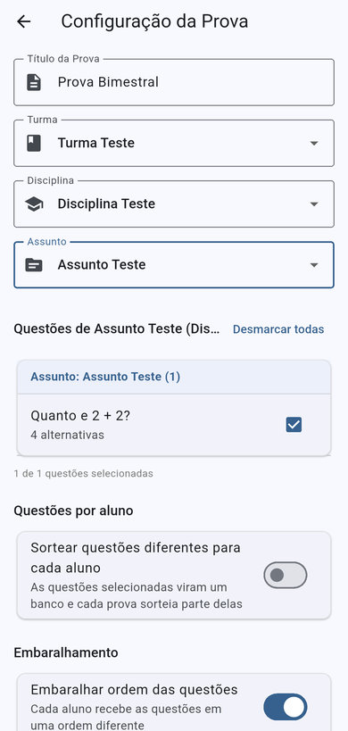 | 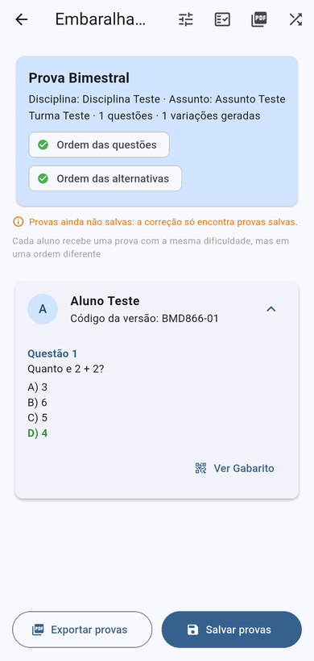 |

| Folha de Respostas (PDF) |
|:---:|
| 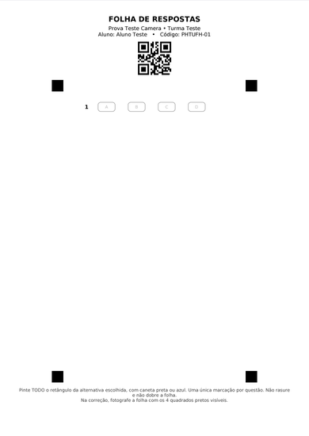 |

**Correção:** leitura do QR Code da versão, captura da folha pela câmera, conferência das marcações e resultado da correção.

| Leitura do QR Code | Leitura da Folha |
|:---:|:---:|
| 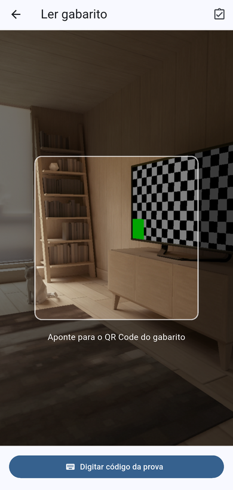 | 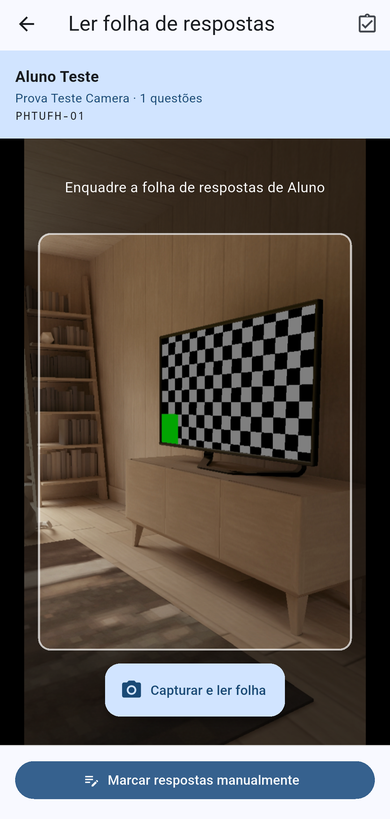 |

| Conferência | Resultado |
|:---:|:---:|
| 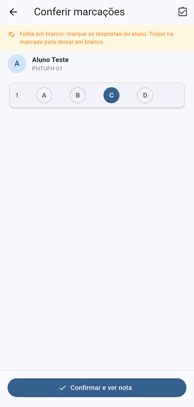 | 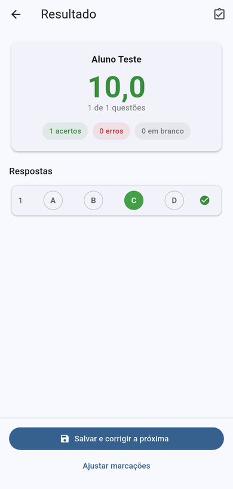 |

**Acompanhamento:** visão geral de provas e desempenho, histórico de provas corrigidas, detalhes com a alternativa mais marcada por questão e desempenho por turma.

| Provas e Desempenho | Provas Corrigidas |
|:---:|:---:|
| 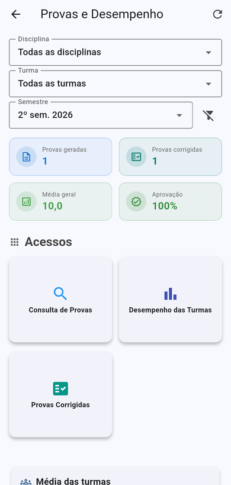 | 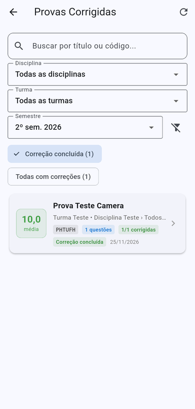 |

| Detalhes da Prova Corrigida | Desempenho das Turmas |
|:---:|:---:|
| 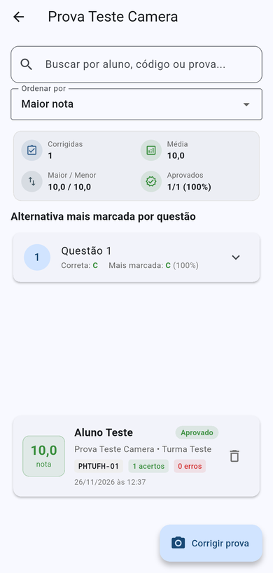 | 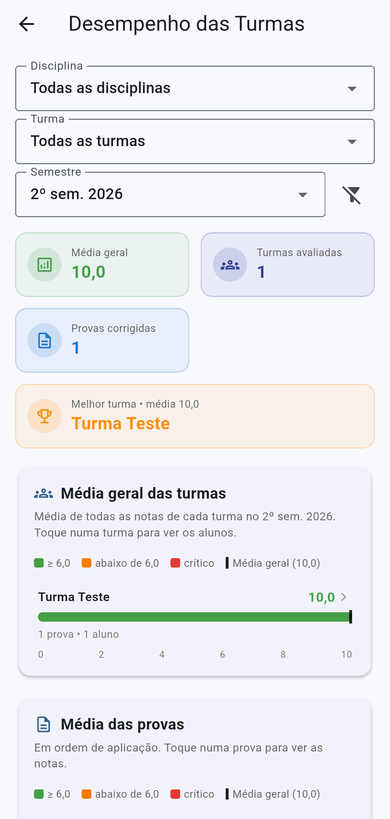 |

## 4. Modelo de Dados

📌 **N3**

Os dados ficam no **Cloud Firestore**, isolados por professor: todas as coleções são subcoleções do documento do professor autenticado (`lib/core/professor_db.dart`).

```text
professores/{uid}
  ├─ alunos/{id}
  ├─ turmas/{id}
  ├─ disciplinas/{id}
  ├─ assuntos/{id}
  ├─ questoes/{id}
  ├─ provas/{id}
  │    └─ versoes/{codigo}
  └─ correcoes/{codigoVersao}
```

| Coleção | Campos principais |
|---|---|
| `professores/{uid}` | `email`, `nome`, `criadoEm` |
| `alunos` | `nome`, `email`, `isAtivo`, `nomeBusca` |
| `turmas` | `nomeTurma`, `ativa`, `alunosIds[]` |
| `disciplinas` | `descricao`, `descricaoBusca` |
| `assuntos` | `nome`, `disciplinaId` |
| `questoes` | `enunciado`, `alternativas[] { texto, isCorreta }`, `disciplinaId`, `assuntoId` |
| `provas` | `titulo`, `turmaId`, `nomeTurma`, `assuntoId`, `nomeAssunto`, `disciplinaId`, `nomeDisciplina`, `questoesIds[]`, `questoesPorProva`, `embaralharQuestoes`, `embaralharAlternativas`, `criadaEm` |
| `provas/{id}/versoes` | `alunoId`, `nomeAluno`, `questoes[] { questaoId, enunciado, alternativas[], respostaCorreta }` |
| `correcoes` | `provaId`, `turmaId`, `alunoId`, `tituloProva`, `nomeTurma`, `nomeAluno`, `respostasMarcadas[]`, `respostasCorretas[]`, `quantidadeAlternativas`, `acertos`, `erros`, `emBranco`, `nota`, `dataHora` |

- O id de cada documento em `versoes` é o **código da versão**, o mesmo gravado no QR Code da prova; a correção usa esse código como id, o que liga a folha lida à versão do aluno.
- Nomes (turma, aluno, assunto, disciplina) são **desnormalizados** em `provas`, `versoes` e `correcoes` para que o histórico continue legível mesmo se o cadastro original mudar.
- Os campos `*Busca` guardam o texto em minúsculas para permitir buscas sem diferenciar maiúsculas.

## 5. Stack Tecnológica

📌 **N1 / N2 / N3**


- **Flutter**: Framework de UI multiplataforma utilizado para construir toda a interface visual e a navegação responsiva do aplicativo.
- **Dart**: Linguagem de programação orientada a objetos que alimenta a lógica de negócio, controladores e serviços por trás do Flutter.
- **Firebase (Auth & Firestore)**: Plataforma de backend-as-a-service utilizada para gerenciar o banco de dados NoSQL em nuvem e a autenticação segura dos professores.
- **OpenCV (`opencv_dart`)**: Biblioteca de visão computacional utilizada na detecção óptica de marcações (OMR) das folhas de respostas.

Principais pacotes:

| Pacote | Uso |
|---|---|
| `firebase_core`, `firebase_auth`, `cloud_firestore` | Autenticação e persistência em nuvem |
| `camera`, `opencv_dart` | Captura e leitura óptica (OMR) da folha de respostas |
| `mobile_scanner`, `qr_flutter` | Leitura e geração do QR Code de cada versão da prova |
| `pdf`, `printing` | Geração, impressão e compartilhamento das provas e gabaritos |
| `file_picker`, `csv`, `excel` | Importação de alunos por planilha |

## 6. Estrutura de Pastas

📌 **N1 / N2 / N3**

O projeto adota uma **Clean Architecture (Feature-First)**, que agrupa os arquivos pelas funcionalidades reais de negócio em vez de seus tipos técnicos. Isso garante alta coesão e baixo acoplamento:

```text
lib/
  core/               # Infraestrutura compartilhada (ex: professor_db.dart, raiz dos dados no Firestore)
  features/
    aluno/            # Alunos: cadastro, listagem e importação por planilha
    auth/             # Autenticação: login, cadastro e recuperação de senha
    correcao_prova/   # Câmera, leitura de QR Code, OMR (OpenCV) e provas corrigidas
    dashboard/        # Menu principal (hub de navegação)
    disciplina/       # Disciplinas e assuntos
    geracao_prova/    # Configuração, embaralhamento, gabarito e estatísticas
    professor/        # Perfil do professor
    provas/           # Provas e versões, exportação em PDF e dashboards de desempenho
    questoes/         # Banco de questões (CRUD)
    turma/            # Turmas
  widgets/            # Componentes visuais reaproveitáveis (responsive_container.dart, menu_opcoes.dart)
  firebase_options.dart
  main.dart
test/                 # Testes unitários e de widget (helpers com repositórios em memória)
integration_test/     # Teste de gravação/leitura real no Firestore
assets/fonts/         # Fontes DejaVu embutidas nos PDFs
docs/telas/           # Capturas de tela utilizadas na documentação
```

Dentro de cada funcionalidade (`feature`), os arquivos são subdivididos logicamente em:
- `data/`: Modelos de domínio (`.dart`) e regras de manipulação de dados (repositórios em memória para testes ficam em `test/helpers/`).
- `service/` (ou `services/`): Repositórios e regras de negócio para comunicação externa (ex: integração Firebase).
- `ui/`: Telas e widgets específicos daquela funcionalidade.
- `pdf/` (em `provas`): Montagem e layout dos PDFs.

## 7. Como Executar o Projeto

📌 **N1 / N2 / N3**

**Pré-requisito:** Flutter instalado com Dart SDK `^3.13.0` (conforme `pubspec.yaml`).

1. Clone o repositório na sua máquina:
   ```bash
   git clone https://github.com/FelipeVieira4/gabarito_plus.git
   ```
2. Acesse a pasta do projeto:
   ```bash
   cd gabarito_plus
   ```
3. Instale todas as dependências do Flutter:
   ```bash
   flutter pub get
   ```
4. Certifique-se de que os arquivos de configuração do Firebase (`google-services.json` para Android / `GoogleService-Info.plist` para iOS) e o arquivo `firebase_options.dart` estão configurados no projeto local, conforme as credenciais da equipe. Para gerá-los novamente, use `flutterfire configure`.
5. Conecte um dispositivo físico ou inicie o emulador e rode a aplicação:
   ```bash
   flutter run
   ```

> A leitura óptica (OMR) depende do `opencv_dart` via FFI e não está disponível na versão web; nesse caso a correção é feita pela marcação manual na tela de conferência.

Para contribuir com o repositório, siga o padrão de branches descrito em [`CONTRIBUTING.md`](CONTRIBUTING.md).

## 8. Testes

📌 **N2 / N3**

Os testes unitários e de widget usam repositórios em memória (`test/helpers/`) e não acessam o Firebase:

```bash
flutter test
```

O teste de integração grava provas, versões e correções no Firestore e confere a leitura. As credenciais de um professor de teste são passadas por `--dart-define` e nunca devem ser commitadas:

```bash
flutter test integration_test/firestore_gravacao_test.dart -d <dispositivo> --dart-define=TEST_EMAIL=<email> --dart-define=TEST_PASSWORD=<senha>
```

Acrescente `--dart-define=USE_EMULATOR=true` para usar o emulador local do Firestore. Os documentos criados têm id iniciado por `TESTE-` e são apagados no fim do teste.

## 9. Backlog de Atividades

### 9.1 Backlog da N3

📌 **N3**

#### Enrique Zoz de Souza

| Tarefa | Conclusão | Status |
|---|---|---|
| Implementação do `OmrService` com OpenCV (`opencv_dart`), suporte multiplataforma e testes unitários | 21/11/2026 | Concluído |
| Integração da captura da folha de respostas via câmera com leitura OMR | 21/11/2026 | Concluído |
| Atualização do dashboard e correção de overflow nos cards de provas | 23/11/2026 | Concluído |

#### Felipe Vieira

| Tarefa | Conclusão | Status |
|---|---|---|
| Isolamento do banco de dados no Cloud Firestore por professor (`professores/{uid}`) | 19/11/2026 | Concluído |
| Remodelagem do módulo de provas, dashboards de desempenho e exportação de provas/gabaritos em PDF | 22/11/2026 | Concluído |
| Edição de disciplinas, componente reutilizável de edição/exclusão (`menu_opcoes.dart`) e correção da exclusão de questões | 24/11/2026 | Concluído |

#### Natan Felipe Valente

| Tarefa | Conclusão | Status |
|---|---|---|
| Geração de provas com sorteio aleatório de questões por versão (`questoesPorProva`) | 13/11/2026 | Concluído |
| Estatísticas por alternativa na consulta de provas e provas corrigidas e ajustes de responsividade | 23/11/2026 | Concluído |
| Correção de overflow na tela de consulta de provas corrigidas | 25/11/2026 | Concluído |

#### Vicenzo Luiggi Mori

| Tarefa | Conclusão | Status |
|---|---|---|
| Tela de scanner de QR Code (`mobile_scanner`) para leitura da versão na correção | 18/11/2026 | Concluído |
| Importação de alunos por planilha (`.csv` e `.xlsx`) | 20/11/2026 | Concluído |
| Atualização e consolidação da documentação (`README.md`) para a entrega N3 | 26/11/2026 | Concluído |

#### Esther Rigol de Souza

| Tarefa | Conclusão | Status |
|---|---|---|
| Finalização da integração da câmera e controle de concorrência OMR na `CameraCorrecao` | 22/11/2026 | Concluído |
| Personalização do layout das provas exportadas em PDF (fontes DejaVu, cabeçalho, instruções e espaço para resolução) | 23/11/2026 | Concluído |

### 9.2 Backlog da N2

📌 **N2**

#### Enrique Zoz de Souza

| Tarefa | Tempo (h) | Prazo | Status |
|---|---|---|---|
| Revisão e Estabilização dos Fluxos da N1 | 10 | 06/10/2026 | Concluído |
| Integração do Módulo de Autenticação com Firebase Auth | 12 | 10/10/2026 | Concluído |
| Atualização da Documentação e README da N2 | 6 | 28/10/2026 | Concluído |

#### Felipe Vieira

| Tarefa | Tempo (h) | Prazo | Status |
|---|---|---|---|
| Configuração do Projeto Firebase e SDKs no Flutter | 8 | 08/10/2026 | Concluído |
| Migração de AlunoService e TurmaService para Firestore | 14 | 14/10/2026 | Concluído |
| Testes de Correção e Validação do Fluxo sem Mocks | 12 | 27/10/2026 | Concluído |

#### Natan Felipe Valente

| Tarefa | Tempo (h) | Prazo | Status |
|---|---|---|---|
| Modelagem de Coleções no Cloud Firestore | 10 | 12/10/2026 | Concluído |
| Migração da Geração de Provas e Gabaritos para Firestore | 12 | 18/10/2026 | Concluído |
| Persistência Real dos Resultados de Correções no Firebase | 12 | 20/10/2026 | Concluído |

#### Vicenzo Luiggi Mori

| Tarefa | Tempo (h) | Prazo | Status |
|---|---|---|---|
| Migração de QuestoesService e DisciplinasService para Firestore | 14 | 16/10/2026 | Concluído |
| Desenvolvimento da Tela de Consulta de Provas Corrigidas | 16 | 22/10/2026 | Concluído |
| Revisão Final, Testes de Regressão e Release da N2 | 8 | 29/10/2026 | Concluído |

#### Esther Rigol de Souza

| Tarefa | Tempo (h) | Prazo | Status |
|---|---|---|---|
| Desenvolvimento da Tela de Detalhes da Prova Corrigida | 14 | 24/10/2026 | Concluído |
| Remoção Definitiva de Arquivos Mocks e Teste End-to-End | 8 | 25/10/2026 | Concluído |
